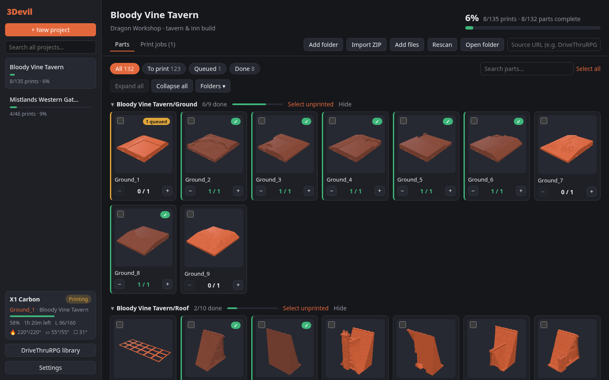

# 3Devil

Cross-platform desktop app (Linux, Windows, macOS) for managing large multi-part 3D print builds — terrain sets, cosplay, big models split into dozens or hundreds of STLs. Track what each build needs, what's printed, and what's on the plate.



## Install

Download the latest installer for your system from the [Releases page](https://github.com/fynflood/3Devil/releases/latest).

The builds aren't code-signed yet, so Windows and macOS will warn the first time you open 3Devil. The steps below get past that once; after that it opens normally.

### Windows 10 / 11

1. Download `3Devil_<version>_x64-setup.exe` (or the `.msi` if you prefer).
2. Run it. If **Windows protected your PC** appears, click **More info → Run anyway**.
3. Start 3Devil from the Start menu.

3Devil uses Microsoft Edge WebView2, which is built into Windows 10 and 11; the installer adds it if it's missing.

### macOS 11 (Big Sur) or newer

1. Download the `.dmg` for your Mac: `aarch64` for Apple Silicon (M1 and later), `x64` for Intel.
2. Open it and drag **3Devil** into **Applications**.
3. Open 3Devil. macOS will say it can't verify the developer. Go to **System Settings → Privacy & Security**, scroll down and click **Open Anyway** next to the 3Devil message, then confirm.

   Or, in Terminal:

   ```bash
   xattr -dr com.apple.quarantine /Applications/3Devil.app
   ```

### Linux

Pick the package for your distribution:

- **Debian, Ubuntu, Mint, Pop!_OS** — download the `.deb`, then:

  ```bash
  sudo apt install ./3Devil_*_amd64.deb
  ```

- **Fedora, RHEL, openSUSE** — download the `.rpm`, then:

  ```bash
  sudo dnf install ./3Devil-*.x86_64.rpm
  ```

- **Any distribution (including Arch)** — download the `.AppImage`, then:

  ```bash
  chmod +x 3Devil_*_amd64.AppImage
  ./3Devil_*_amd64.AppImage
  ```

  AppImages need FUSE 2 (`sudo pacman -S fuse2` on Arch, `sudo apt install libfuse2` on Ubuntu 22.04+).

### Where your data lives

Projects and settings are saved in `state.json` (plus a `.bak` of the previous save):

| OS | Folder |
| --- | --- |
| Windows | `%APPDATA%\tech.ouija.threedevil` |
| macOS | `~/Library/Application Support/tech.ouija.threedevil` |
| Linux | `~/.local/share/tech.ouija.threedevil` |

Uninstalling 3Devil leaves this folder in place. Your model files are never moved or deleted.

## Features

- **Projects** — one per build. Add folders of models, import ZIP downloads (nested ZIPs unpacked), or add loose files. Sub-folders become groups.
- **Quantities** — each part has *needed / printed / failed* counts. Names like `wall_x4.stl` or `4x_barrel.stl` set the needed count automatically.
- **STL / 3MF / OBJ rendering** — cached thumbnails for every part, plus an orbitable 3D viewer with dimensions. Large STLs (hundreds of MB) are simplified in the backend for display; slicers always get the full file.
- **Slicer integration** — select parts and *Send to Bambu Studio* or *PrusaSlicer*; the files open in the slicer and are recorded as a queued **print job**. Tick several parts to send them to one slicer window together, or drag part cards (one, or all ticked ones) onto a slicer window that's already open to add them to its plate; drops within 30 minutes are recorded as one job. PrusaSlicer also takes later sends into the window that's already open (turn this off in *Settings*); Bambu Studio opens a new window for each send. Mark the job *Printed* (counts go up) or *Failed*, or take parts out of it (✕ on a part's yellow *queued* badge or in the job, or *Remove from queue* for a selection). Undo is supported.
- **Progress** — per project, per group and per part, with filters for *To print / Queued / Done*.
- **Folders** — open any folder in your file browser from its folder icon, expand/collapse all, and hide folders that aren't part of the build yet (hidden folders don't count toward progress).
- **Search** — across every project from the sidebar; click a result to jump to the part.
- **Bambu Lab printers** — *Settings → Printers → Find printers*, then enter the printer's LAN access code. The sidebar shows live state, progress, time left, layers and temperatures. A running print whose name matches a part is tracked as a print job automatically; when it ends, 3Devil asks whether it worked (with good-copy counts per part) and records the result and print time.
- **DriveThruRPG** — add a *Library App Key* (from your DriveThruRPG account settings) under *Settings*, then browse your purchases in *DriveThruRPG library* and turn any product into a project: its files are downloaded, unpacked and linked to the store page, and *Download update* appears when the publisher updates the files. The library is saved after the first load, so later it opens straight away and refreshes in the background. This uses the same unofficial API as DriveThruRPG's library app (endpoints courtesy of [drpg](https://github.com/glujan/drpg)), so it may break if they change it. Downloaded ZIPs work too: *New project → From ZIP*.

Slicers are auto-detected (PATH, Flatpak, standard install locations) and can be overridden in **Settings**. **Settings → Appearance** switches between light and dark, or follows your system.

## Building from source

You need [Node.js](https://nodejs.org/) 20.19 or newer and [Rust](https://rustup.rs/) (stable), plus your OS's build tools:

- **Windows** — [Microsoft C++ Build Tools](https://visualstudio.microsoft.com/visual-cpp-build-tools/) with the *Desktop development with C++* workload.
- **macOS** — Xcode command-line tools: `xcode-select --install`.
- **Debian / Ubuntu**

  ```bash
  sudo apt install build-essential curl wget file libssl-dev libwebkit2gtk-4.1-dev libayatana-appindicator3-dev librsvg2-dev libxdo-dev
  ```

- **Fedora**

  ```bash
  sudo dnf install webkit2gtk4.1-devel openssl-devel curl wget file libappindicator-gtk3-devel librsvg2-devel libxdo-devel
  sudo dnf group install c-development
  ```

- **Arch**

  ```bash
  sudo pacman -S --needed base-devel webkit2gtk-4.1 curl wget file openssl appmenu-gtk-module libappindicator-gtk3 librsvg xdotool
  ```

Then:

```bash
git clone https://github.com/fynflood/3Devil.git
cd 3Devil
npm ci
npm run tauri build
```

Installers end up in `src-tauri/target/release/bundle/`.

### Development

```bash
npm run tauri dev       # desktop app with hot reload
npm run dev             # UI only, in a browser, with a mocked backend
cd src-tauri && cargo test
```

### Releases

Pushing a version tag builds installers for every platform on GitHub Actions (`.github/workflows/release.yml`) and attaches them to a draft release to review and publish:

```bash
git tag v0.1.0
git push origin v0.1.0
```

The tag should match `version` in `src-tauri/tauri.conf.json`.

## Layout

- `src-tauri/src/lib.rs` — backend commands: state persistence, folder scanning, ZIP extraction, slicer detection/launch.
- `src-tauri/src/preview.rs` — simplified copies of large STLs for thumbnails and the viewer.
- `src-tauri/src/drivethru.rs` — DriveThruRPG library listing and downloads.
- `src-tauri/src/printer.rs` — Bambu Lab printer discovery and live status over the printer's local MQTT (TLS, port 8883).
- `src/printers.ts` — printer connections, matching prints to parts, recording finished prints.
- `src/store.ts` — app state and all project/part/job actions.
- `src/viewer/` — three.js model loading, interactive viewer, thumbnail cache (IndexedDB).
- `src/components/` — UI.
